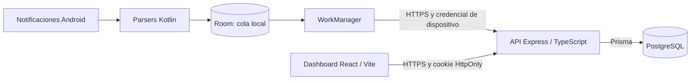

# Gestor Financiero — MVP

Gestor financiero personal que captura movimientos desde notificaciones Android
de **IO, Yape y Google Wallet**, los conserva sin conexión y los sincroniza con
un backend. El dashboard web permite consultar, filtrar, crear y corregir
movimientos y asignar categorías.

Repositorio público: [`Vilelapl/v1.0.0-mvp-public`](https://github.com/Vilelapl/v1.0.0-mvp-public).
El MVP está validado localmente; el despliegue permanente sigue pendiente.

## Qué incluye

- Captura Android con parsers por fuente y almacenamiento durable en Room.
- Sincronización mediante WorkManager, reintentos y autenticación de dispositivo.
- API de movimientos, categorías y resúmenes con PostgreSQL y Prisma.
- Dashboard con sesión segura, filtros, edición, alta manual y resumen mensual.
- Vista del ciclo de la tarjeta iO, del día 26 al 25, con totales por moneda.
- Emparejamiento Android mediante código temporal y credencial en Keystore.
- Migraciones, bootstrap del propietario, seed y pruebas automatizadas.

**Límite financiero:** IO y Wallet pueden informar el mismo pago y generar dos
filas que cuentan en los totales. Se evita duplicar el reenvío del mismo UUID;
la deduplicación entre fuentes está fuera del MVP. No hay conversión entre monedas.

## Arquitectura



El backend es la única capa con acceso a PostgreSQL. Android conserva la cola
local hasta poder sincronizar; el navegador accede a la información mediante la API.

| Componente | Tecnologías |
|---|---|
| Android | Kotlin, SDK 36, Room, WorkManager, Retrofit/OkHttp, Keystore |
| Backend | Node.js 24, TypeScript, Express 5, Zod, Prisma 7 |
| Persistencia | PostgreSQL; validación local con 18.4 |
| Web | React, TypeScript, Vite, `fetch`, Temporal |
| Pruebas | Vitest, Supertest, Testing Library, JUnit, Robolectric, MockWebServer |

Las versiones concretas están fijadas en los lockfiles y archivos Gradle.

## Empezar

```text
git clone https://github.com/Vilelapl/v1.0.0-mvp-public.git
cd v1.0.0-mvp-public
```

Para desarrollar, instala Node.js 24,
npm y PostgreSQL. Android requiere un JDK compatible con Gradle 8.13 y Android
SDK 36; los detalles y comandos están en la [guía de instalación](docs/GITHUB.md).

1. Crea una base de desarrollo y otra desechable de pruebas cuyo nombre contenga
   `test`. Copia `.env.example` a `backend/.env` y completa los valores locales.
2. En `backend/`, ejecuta `npm ci`, `npm run prisma:generate`,
   `npm run prisma:migrate:deploy`, `npm run bootstrap` y `npm run db:seed`.
   El bootstrap requiere el email del propietario y una contraseña propia.
3. Inicia el backend con `npm run dev`. En otra terminal, desde `web/`, ejecuta
   `npm ci` y `npm run dev`; abre `http://127.0.0.1:5173`.
4. Para Android, configura `JAVA_HOME` y `ANDROID_HOME` y sigue la
   [guía de compilación, permisos y emparejamiento](android/README.md).

La primera instalación descarga dependencias. No se distribuyen `.env`, bases
locales, credenciales, APKs ni cachés. Los ejemplos de entorno contienen valores
ficticios. Las instrucciones para producción están en [PRODUCCION.md](docs/PRODUCCION.md).

## Documentación

| Tema | Documento |
|---|---|
| Índice y orden de lectura | [Documentación del proyecto](docs/README.md) |
| Requerimientos implementados y límites | [Requerimientos del MVP](docs/REQUERIMIENTOS.md) |
| Definición y criterios de aceptación del MVP | [Alcance cerrado](contexto/MVP.md) |
| Componentes, flujos y decisiones | [Arquitectura del sistema](docs/ARQUITECTURA.md) |
| Entidades, campos y reglas de persistencia | [Definiciones de datos](docs/DATOS.md) |
| API, autenticación y comportamiento detallado | [Referencia técnica](docs/REFERENCIA_TECNICA.md) |
| Instalación y trabajo con Git | [Guía de desarrollo](docs/GITHUB.md) |
| Operación, HTTPS y backups | [Producción](docs/PRODUCCION.md) |
| Resultados de validación de esta copia | [Preparación y verificación](docs/PREPARACION_GITHUB.md) |
| Historial técnico y pendientes | [Estado del proyecto](ESTADO_PROYECTO.md) |

## Estructura

```text
android/    App Kotlin, pruebas, esquemas Room y Gradle Wrapper
backend/    API Express, Prisma, migraciones, bootstrap y pruebas
web/        Dashboard React/Vite y pruebas de interfaz
docs/       Guías, referencias y resultados de validación
contexto/   Definición del MVP y documentos de diseño originales
deploy/     Plantilla nginx para web y API bajo el mismo origen
```

## Validación

Comprobaciones realizadas sobre esta copia el **1 de octubre de 2026**:

| Componente | Resultado |
|---|---|
| Backend | 112 pruebas; typecheck, build y migraciones en una base vacía correctos |
| Web | 91 pruebas; typecheck y build correctos |
| Android | 63 pruebas debug y 63 release; APK debug generado |
| Android lint | 0 errores y 26 advertencias por variante |

Los comandos, condiciones del entorno y límites están en el
[informe de verificación](docs/PREPARACION_GITHUB.md). Las referencias a `.cache/`
en informes históricos corresponden a evidencias locales excluidas del repositorio.

## Alcance y próximos pasos

El MVP contempla un propietario creado administrativamente; no ofrece registro
público. No incluye correo, IA, categorización automática, conciliación,
deduplicación entre fuentes, presupuestos ni iOS. El documento de requerimientos
original describe una visión más amplia y se conserva como antecedente.

Para uso permanente faltan el despliegue del backend y PostgreSQL, dominio/HTTPS,
la firma de distribución Android y resolver los pendientes operativos descritos
en la guía de producción. Subir este repositorio no despliega los servicios.

El nombre `v1.0.0-mvp-public` identifica este repositorio. Las versiones internas
actuales se conservan en `0.1.0`; no se ha creado automáticamente un tag o una release.
Para contribuir, consulta [CONTRIBUTING.md](CONTRIBUTING.md).
