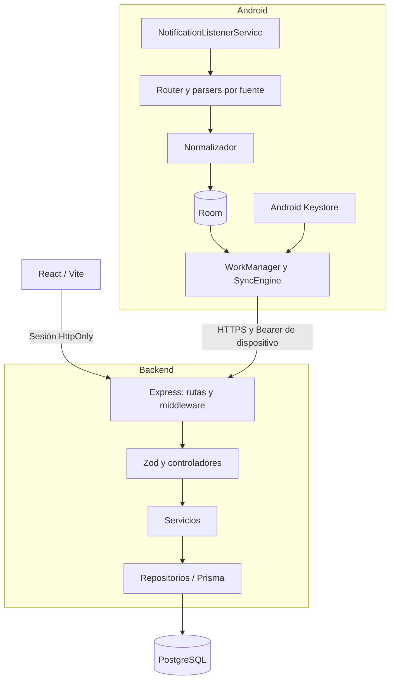

# Arquitectura del sistema

## Componentes

| Capa | Responsabilidad |
|---|---|
| Android | Capturar, normalizar, persistir localmente y sincronizar |
| Backend | Autenticar, validar, aplicar reglas, aislar propietarios y persistir |
| PostgreSQL | Datos del servidor, restricciones, transacciones y consultas |
| Web | Sesión, filtros, formularios, tablas y resúmenes; sin acceso directo a la base |

## Captura y recuperación

1. Android recibe una notificación de una fuente soportada.
2. El parser extrae exclusivamente los campos que el formato permite conocer.
3. El normalizador construye una captura con un UUID y la guarda en Room.
4. WorkManager programa el envío cuando existe conectividad. El motor reclama
   filas de manera transaccional y conserva la identidad durante los reintentos.
5. La API autentica el dispositivo y deriva el propietario desde esa credencial.
6. Prisma persiste el movimiento; la unicidad de `(userId, clientTransactionId)`
   evita duplicados en reenvíos concurrentes. La respuesta confirma el ID servidor.
7. Android actualiza el estado local. Los errores recuperables conservan la fila
   para reintento; una credencial inválida puede requerir reemparejamiento.

Dos eventos distintos de IO y Wallet conservan UUIDs distintos aunque representen
el mismo pago. La idempotencia no realiza conciliación financiera entre fuentes.

## Autenticación

- **Web:** propietario creado con bootstrap, contraseña Argon2id y sesión opaca.
  Cookie `HttpOnly`, `SameSite=Strict` y `Secure` en producción. Las mutaciones
  con cookie verifican el origen; login y pairing tienen límites de frecuencia.
- **Android:** un código temporal vincula el dispositivo al propietario. El
  backend conserva el hash de su credencial y permite revocarla. Android la cifra
  con una clave de Keystore; la web no recibe el token del dispositivo.
- **Base de datos:** solo el backend accede a PostgreSQL. El cliente no decide
  `userId`, `deviceId` ni metadatos de auditoría del servidor. La fuente enviada
  por Android se valida contra el enum permitido.

El dashboard no incorpora todavía una pantalla de gestión de dispositivos;
los endpoints están descritos en la [referencia técnica](REFERENCIA_TECNICA.md).

## Desarrollo y producción

En desarrollo, Vite escucha en `127.0.0.1:5173` y reenvía `/api` al backend local,
normalmente en `127.0.0.1:3000`. Los orígenes se configuran explícitamente.

La configuración de producción prevista sirve web y API bajo el mismo origen,
con HTTPS terminado en el proxy y PostgreSQL en una red privada. La plantilla
[nginx](../deploy/nginx.conf.example) y la [guía operativa](PRODUCCION.md) detallan
migraciones, permisos mínimos, disponibilidad, backups y restauración.
El repositorio no implica que esos servicios estén desplegados.

## Decisiones y límites

- Monorepo con tres aplicaciones y contratos compartidos por documentación/pruebas.
- Dinero decimal y resúmenes separados por moneda; no hay tipo de cambio.
- Instantes UTC en backend y visualización en Lima.
- Room es una cola local durable; PostgreSQL es la persistencia del servidor.
- El rate limit es local al proceso; múltiples réplicas necesitan una solución compartida.
- No hay envío de correo, IA, deduplicación entre fuentes ni tareas CI/CD configuradas.

Consultar también [el diseño original detallado](../contexto/ARQUITECTURA_MVP.md),
[las definiciones de datos](DATOS.md) y [el código del backend](../backend/src/).
