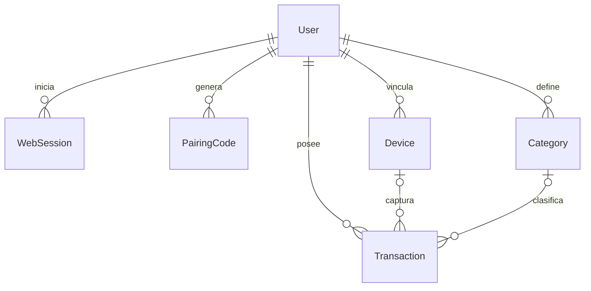

# Definiciones de datos

El modelo efectivo está en [schema.prisma](../backend/prisma/schema.prisma) y las
[migraciones SQL](../backend/prisma/migrations/). El
[documento original de modelamiento](../contexto/MODELAMIENTO_DATOS_MVP.md) desarrolla
DTOs, retención y decisiones de diseño.

## Entidades del servidor

| Entidad | Tabla | Propósito y campos relevantes |
|---|---|---|
| `User` | `users` | Propietario: UUID, email único, hash de contraseña y timestamps |
| `WebSession` | `web_sessions` | Hash del token de sesión, expiración y revocación |
| `PairingCode` | `pairing_codes` | Hash de código temporal, expiración y momento de consumo |
| `Device` | `devices` | Nombre, hash de credencial, última actividad y revocación |
| `Category` | `categories` | Nombre y nombre normalizado; unicidad por propietario |
| `Transaction` | `transactions` | Movimiento financiero, origen, estado y auditoría |

Los tokens de sesión y dispositivo y los códigos de pairing se almacenan como
hashes; las contraseñas como Argon2id. No se incorporan valores reales al repositorio.

## Movimiento financiero

| Campo | Tipo | Regla |
|---|---|---|
| `id` | UUID | Identidad del servidor |
| `userId` | UUID | Propietario derivado de la autenticación |
| `deviceId` | UUID opcional | Dispositivo de captura; nulo en altas manuales |
| `clientTransactionId` | UUID opcional | Estable en Android; nulo en altas manuales |
| `amount` | `Decimal(14,2)` | Importe positivo; DTO como string, hasta 12 dígitos enteros |
| `currency` | 3 caracteres o nulo | Código en mayúsculas cuando se conoce; no se deduce una moneda desconocida |
| `occurredAt` | `timestamptz(3)` | Instante con precisión de milisegundos |
| `description` | Texto opcional, máximo 300 | Descripción editable; ausencia permitida |
| `type` | `income` / `expense` | El signo se expresa en el tipo; el importe es positivo |
| `account` | Texto opcional, máximo 120 | Etiqueta de cuenta o tarjeta; no es una entidad bancaria |
| `categoryId` | UUID opcional | Categoría del mismo propietario |
| `source` | Enum | `io_notification`, `yape_notification`, `google_wallet_notification`, `manual` |
| `processingStatus` | Enum | `automatic`, `manually_modified`, `manually_created` |
| `createdAt`, `updatedAt` | `timestamptz(3)` | Auditoría de creación y modificación |

La API rechaza campos desconocidos y no permite que el cliente fije la identidad
del propietario o la auditoría. Las reglas HTTP se encuentran en
[transactions.schemas.ts](../backend/src/modules/transactions/transactions.schemas.ts).
El DTO público omite IDs internos de propietario/dispositivo y el UUID cliente.

## Integridad e idempotencia

- Unicidad de `(userId, clientTransactionId)` para capturas Android.
- Un reenvío confirmado devuelve `already_exists` y conserva las correcciones web.
- Categorías únicas por `(userId, normalizedName)`.
- Los rangos temporales usan inicio inclusivo y fin exclusivo.
- Las respuestas monetarias se formatean con dos decimales; las sumas se calculan
  en PostgreSQL y se agrupan por moneda, incluyendo un grupo para moneda desconocida.
- Las capturas de fuentes distintas no se fusionan, aunque describan el mismo pago.
- La moneda y los textos opcionales pueden ser nulos; no se completan inventando datos.

## Cola Android

La [entidad Room](../android/app/src/main/java/com/gestorfinanciero/data/local/PendingTransactionEntity.kt)
conserva la transacción normalizada y los metadatos de envío: UUID cliente,
estado, intentos, siguiente reintento, último error y confirmación del servidor.
El [esquema Room versionado](../android/app/schemas/) permite reproducir su estructura.

Los estados locales son `pending`, `syncing`, `retry`, `synced` y `failed`.
Son distintos del `processingStatus` financiero del servidor. Los reclamos y
recuperaciones de envío son transaccionales, y un worker atrasado no puede
sobrescribir el resultado de un intento posterior.

## Privacidad y fixtures

Las muestras de notificaciones de las pruebas sustituyen nombres, tarjetas,
importes y códigos privados según la redacción documentada. Las bases locales,
backups, credenciales, keystores y archivos de entorno reales quedan excluidos
por `.gitignore`. La hora `postTime` puede ser el fallback de captura cuando
la notificación no trae fecha financiera; esa distinción se conserva en las guías.
